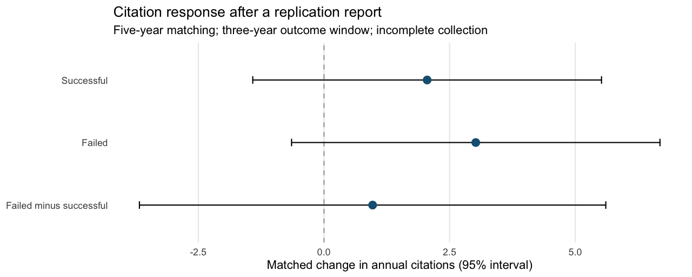

# Citation responses to replication assessments

Do citations change after a study is replicated, and does the response differ
between successful and failed replications? We compare original papers with
papers from the same journal and publication year, matching on citation histories
before the replication report.

[Research note (PDF)](ms/main.pdf) · [Results](docs/results.md) · [Research design](docs/study_design.md) · [Data](data/README.md)

<!-- results:start -->
The current analysis includes **227 comparisons matched on five pre-report years** and **365 shorter-window comparisons**. Collection is incomplete, and matching diagnostics limit causal interpretation.
<!-- results:end -->



## Reproduce

Use R 4.6, Make, and a LaTeX distribution providing XeLaTeX, BibTeX, and latexmk:

```sh
make restore
make check
```

`make paper` rebuilds the research note in `ms/main.pdf` from the same analysis;
it also requires XeLaTeX, BibTeX, and latexmk. The LaTeX source and validated
bibliography are in `ms/`.

`make restore` installs the versions in `renv.lock`. `make analysis` rebuilds the
current results and figure from committed inputs, without an API key or private
cache. `make check` also runs R lint and focused checks of numerical results,
chronology, data integrity and spending limits, then compiles the research note. `make ci-docker` runs the same
checks in the standard `rocker/r-ver:4.6.0` image.

## Files and pipeline

| Path | Purpose |
|---|---|
| `data/raw/replications/` | FLoRA records, verified metadata, comparison pools and collected citation histories |
| `data/raw/i4r/` | I4R assessment records, evidence links and collected histories |
| `data/derived/` | Rebuildable intermediate R objects; ignored by Git |
| `R/` | Reusable functions for preparation, collection, matching, estimation and reporting |
| `scripts/00_config.R` | Paths, observation windows and sampling settings |
| `scripts/01_prepare_data.R` | Validate inputs and establish first recorded report events |
| `scripts/02_match.R` | Select controls using pre-report citations and construct contrasts |
| `scripts/03_estimate.R` | Estimate outcome-specific responses, uncertainty and sensitivities |
| `scripts/04_report.R` | Write the results page and figure |
| `scripts/99_run_all.R` | Run the analysis stages in order |
| `tabs/` | Current estimates, individual contrasts, matching diagnostics and exclusions |
| `tests/testthat/` | Numerical and data-integrity checks |

## Extend collection

```sh
Rscript scripts/acquire.R metadata --fetch
Rscript scripts/acquire.R pools --fetch
Rscript scripts/acquire.R histories --fetch
```

Set `OPENALEX_API_KEY` or store the key in `~/.config/openalex/api_key`.
All OpenAlex collection stages default to zero prepaid spending. An explicitly
authorized `--max-paid-usd=3` sets a cumulative cap; interrupted requests retain
reservations against it. Complete histories are reused. API credentials and
working caches stay local. `Rscript scripts/acquire.R sources --fetch` downloads
the pinned source CSVs using `gh` and checks their hashes.

The outcome is attention, not agreement. A later [citation-context study](docs/citation_context.md)
will examine whether citing papers rely on a challenged finding or acknowledge a
concern. No completed context ratings are reported. [Related research](docs/prior_work.md)
sets out the precedents and the potential contribution.

Code is [MIT licensed](LICENSE). Source attribution and data reuse terms are in
[data/README.md](data/README.md); citation metadata are in [CITATION.cff](CITATION.cff).
