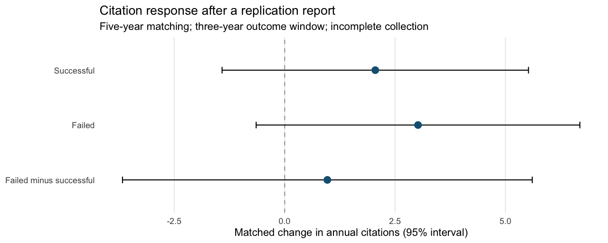

# Citation responses to replication assessments

Five-year pre-report matching yields **227 originals**. The failed-minus-successful contrast is **+0.97 citations per paper per year**, with a 95% interval of **[-3.67, 5.61]**.

The roster has 1068 originals eligible for matching: 568 source-coded successful and 500 failed replications. The shorter window has 365 completed comparisons. The windows overlap; their sample sizes must not be added.

| Window | Replication outcome | Originals | Matched change/year | 95% interval |
|---|---|---:|---:|---|
| 3-year match; 3 before / 3 after | successful | 138 | +2.99 | [-0.12, +6.11] |
| 3-year match; 3 before / 3 after | failed | 144 | +3.28 | [+0.11, +6.45] |
| 3-year match; 3 before / 3 after | failed minus successful | 282 | +0.29 | [-3.62, +4.19] |
| 2-year match; 2 before / 1 after | successful | 180 | +1.57 | [-0.24, +3.38] |
| 2-year match; 2 before / 1 after | failed | 185 | +2.31 | [+0.13, +4.49] |
| 2-year match; 2 before / 1 after | failed minus successful | 365 | +0.74 | [-1.81, +3.29] |
| 5-year match; 3 before / 3 after | successful | 115 | +2.05 | [-1.42, +5.52] |
| 5-year match; 3 before / 3 after | failed | 112 | +3.02 | [-0.65, +6.69] |
| 5-year match; 3 before / 3 after | failed minus successful | 227 | +0.97 | [-3.67, +5.61] |

Collection is incomplete: 10121 requested histories remain unavailable under the spending cap. Of the 227 originals matched on five years, 81 lie outside their sampled comparison pool's baseline citation range. Held-out pre-period changes also differ from zero. These diagnostics weaken a causal interpretation.

The event is the first recorded journal publication of a replication report, not verified first public disclosure. Source success criteria vary. Citation counts measure attention, not agreement. The difference between the two estimates is not the causal effect of failing rather than succeeding.

Intervals use two-way paper/report clustering, conditional on matches and classifications. See [the design](study_design.md), [source data](../data/README.md), and [estimates and diagnostics](../tabs/).
